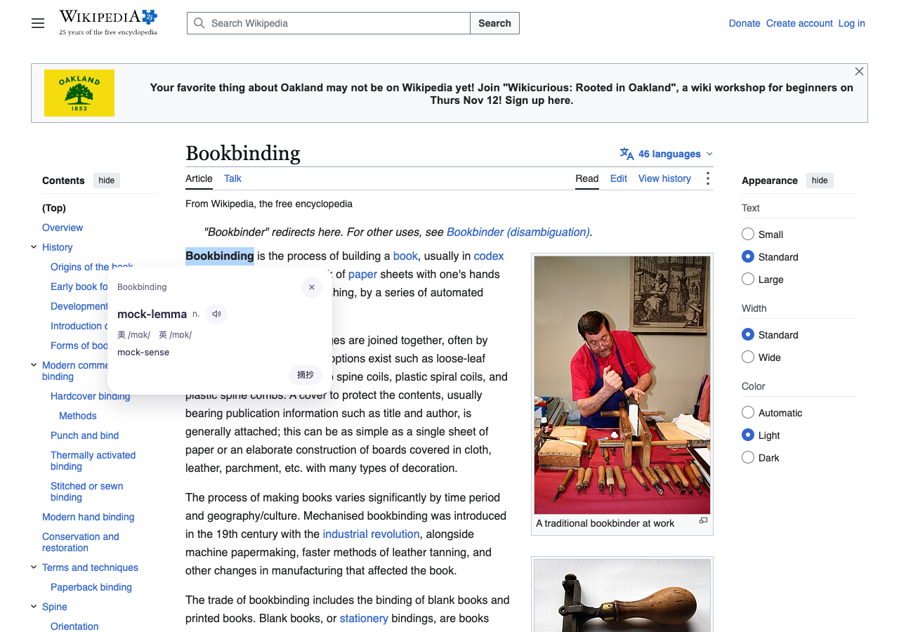
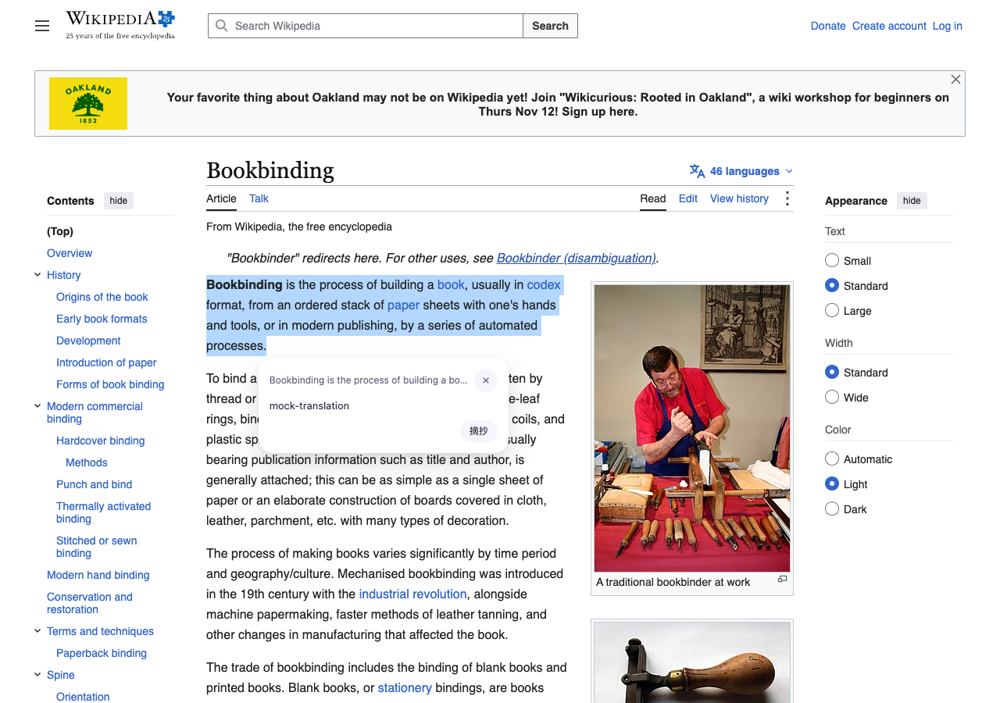
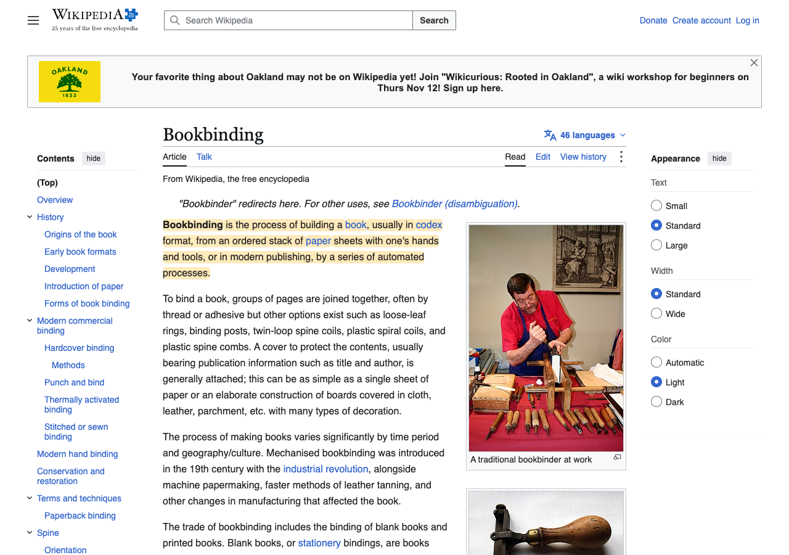
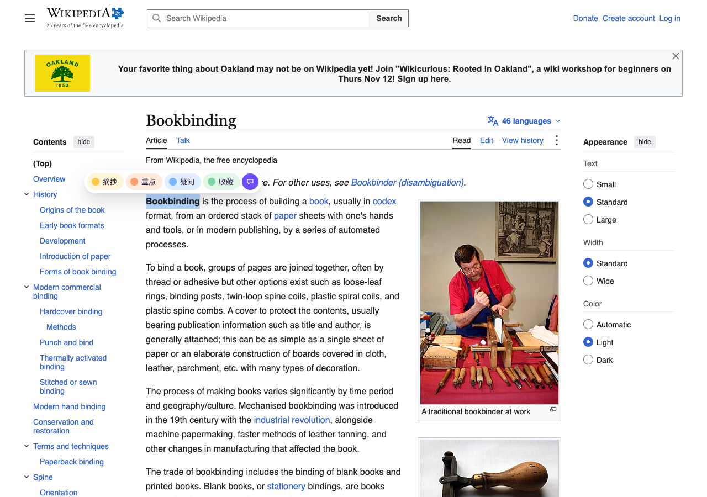

# 测试报告：划词翻译（单词释义 + 音标 + 发音，句子译文）

## 结论

划词翻译按 spec 实现并验证通过：在真实页面（英文维基百科 Bookbinding）上，用当前分支构建选中单词，可以得到原形、美/英音标、释义和发音按钮；选中整句可以得到译文；卡片里点「摘抄」仍能正常高亮。用 main 构建做对照，同样的操作没有翻译入口，也没有发出任何翻译请求。全量回归中，lint、typecheck、单测、浏览器测试、模块边界、集成测试、构建和体积检查都通过；e2e 有 2 个与本功能无关的用例在全量并发下超时，单独重跑通过。

模型接口在所有自动化验证里都是拦截后返回固定结果，原因是 DeepSeek Key 余额不足（HTTP 402）。真实模型的翻译质量、音标准确率和延迟没有验证。

## 改动

- 背景 / 问题：读英文网页时，需要不离开页面就能查词、读懂句子。单词要按上下文给出义项、音标和发音。
- 原因：新需求（spec：`issue-translate-selection.md`）。
- 改动（提交 03b03fa..44e3da0）：
  - `src/features/translate/background/`：`translate/lookup` 等消息处理、OpenAI 兼容客户端（默认 `deepseek-flash`，关闭 thinking，JSON 模式，内容为空或格式不对时重试 1 次）、HTTP 状态到错误码的映射、15s 超时与取消、LRU 缓存（存 `storage.session`）、翻译右键菜单。
  - `src/core/settings/translate-config.ts`：翻译配置存在本机，不同步到云端，登出也不清除。
  - `src/features/translate/sidebar/TranslateSettings.tsx`：侧边栏设置，登录页和账户面板都有入口；Key 遮挡显示，面板只拿到末 4 位；点保存时按接口地址的 origin 申请权限。
  - `src/features/translate/inpage/`：翻译卡片、上下文提取（选区所在句子加前后各一句）、`speechSynthesis` 发音。
  - `manifest.config.ts`：新增 `optional_host_permissions: ['https://*/*']`，常驻权限不变。
  - highlight 模块的改动只有三处注入点：浮动菜单的 `onTranslate`、Esc 能关闭任意浮层、`addMenu`。highlight 不 import translate。
- 已知限制：
  - 未登录时浮动菜单不出现（沿用原有的登录门槛），只能从右键菜单翻译。
  - 没有英文语音的系统上，发音按钮会禁用。
  - 音标完全依赖模型返回，没有词典兜底。

## 验收标准

| 标准 | 指标 | 结果 |
|---|---|---|
| 选中单词后菜单出现翻译按钮 | `[data-noteit-menu] button[aria-label="翻译"]` 数量 | 通过：main 构建 0 个，当前分支 1 个 |
| 单词卡片显示原形、音标、释义，请求带上了所在句子 | 卡片 `data-noteit-translate-state="word"`；lemma、IPA、sense 节点有文字；请求正文包含所在句子 | 通过：state=word，IPA 为「美 /mɑk/ 英 /mɒk/」，有 1 个发音按钮，请求包含整句 |
| 句子卡片显示译文 | state=`text`；translation 节点有文字 | 通过 |
| 不点击就不外发请求 | 点翻译之前，发往接口的请求数 | 通过：0 |
| 卡片不遮挡选区 | 卡片顶部 y ≥ 选区底部 y | 通过：单词 380 ≥ 374，句子 458 ≥ 452 |
| 原有高亮流程不受影响 | 卡片里点「摘抄」后 `liveRecords` 增加，页面上有高亮元素 | 通过：1 条记录，8 个高亮元素；截图偏黄像素从 14,142 增加到 33,764 |

## 测试环境

- macOS，Playwright Chromium（headless），Node 24.16
- 本地 Supabase（docker），测试账号 user A
- 对照组：main（b78db9c）构建 vs 当前分支（44e3da0）构建
- 模型接口：用 `context.route` 拦截 `https://api.deepseek.com/**`，返回固定 JSON

## 1. 真实页面验证（en.wikipedia.org/wiki/Bookbinding）

脚本自动选取正文第一段，取其中最长的单词（Bookbinding）和第一句。

| 检查项 | 修复前（main） | 修复后（当前分支） |
|---|---|---|
| 浮动菜单出现 | 是 | 是 |
| 翻译按钮 | 无 | 有 |
| 点击前请求数 | 0 | 0 |
| 单词卡片 | 无 | word，lemma/IPA/sense 齐全，有发音按钮 |
| 句子卡片 | 无 | text，有译文 |
| 请求次数（单词 + 句子） | 0 | 2，请求正文 226 / 412 字符（段落 198 字符） |
| 从卡片摘抄 | — | 1 条记录，8 个高亮元素 |

单词卡片：

句子卡片：

从卡片摘抄后：

对照（main 构建，选中后只有高亮菜单）：

## 2. 新增回归用例

| 用例 | 层级 | 修复前 | 修复后 |
|---|---|---|---|
| `handlers.test.ts`（29 个：单词/句子判定、JSON 映射、重试、状态码映射、超时/取消、缓存、配置校验） | unit | 模块不存在 | 通过 |
| `context.test.ts`（6 个：句子窗口、全角标点、截断） | unit | 模块不存在 | 通过 |
| `menu.test.ts`（4 个：右键菜单、打开设置） | unit | 模块不存在 | 通过 |
| `commands.test.ts`：其他 feature 的菜单项在同一个 `removeAll` 回调里创建 | unit | 无 `addMenu` | 通过 |
| `translate-settings.e2e.ts`（4 个） | e2e | 4 个全部失败（没有设置行） | 通过 |
| `translate-card.e2e.ts`（5 个，包括对卡片跑 axe） | e2e | 5 个全部失败（没有翻译按钮和卡片） | 通过 |
| `translate-menu.e2e.ts`（2 个：未登录 + 站点关闭时的右键翻译） | e2e | 1 个失败；"没有选中文字时不出现卡片"在 main 上也通过，因为它断言的是卡片不存在 | 通过 |

e2e 对照的做法：把 `dist/` 换成 main（b78db9c）的构建，跑上面三个文件，结果是 11 个用例里 10 个失败、1 个通过。
| `manifest.test.ts` / `network-origins.e2e.ts`：optional host 权限 | unit / e2e | 失败（断言为空） | 通过 |

## 3. 全量回归（`node scripts/verify.ts --no-install`）

| 套件 | 结果 |
|---|---|
| lint | 通过（1 个 warning，等于基线） |
| typecheck | 通过 |
| 单元测试 `test:unit` | 通过：614 个，跳过 2 个 |
| 浏览器测试 `test:browser` | 通过：49 个 |
| 模块边界 `test:module-boundary` | 通过 |
| 集成测试 `test:integration` | 通过：54 个 |
| build + `scan:dist` | 通过：content script gzip 34.3KB，上限 37.9KB |
| e2e `--project=e2e` | 116 个通过，2 个失败（`sidepanel-jump`、`sidepanel-local-db`，全量下分别跑了 19.5s / 32.9s 超时）；这 2 个单独重跑，5 个用例全部通过 |
| corpus `test:corpus` | 通过 |
| perf `test:perf` | 通过 |

## 未覆盖

- 真实 DeepSeek 接口：Key 余额不足，没有验证翻译质量、音标准确率、延迟和费用。
- `speechSynthesis` 的实际发声：headless 环境里听不到，只验证了按钮存在，点击后页面没有报错。
- 在 Chrome 真实界面里点保存时会不会弹出 optional 权限授权框：e2e 证明了不等授权结果也能完成保存，但没有人工点过授权框。
- 只在 Chromium 上测过，没有覆盖 Edge、Arc 等。
- 只验证了默认的 mark 渲染器。
