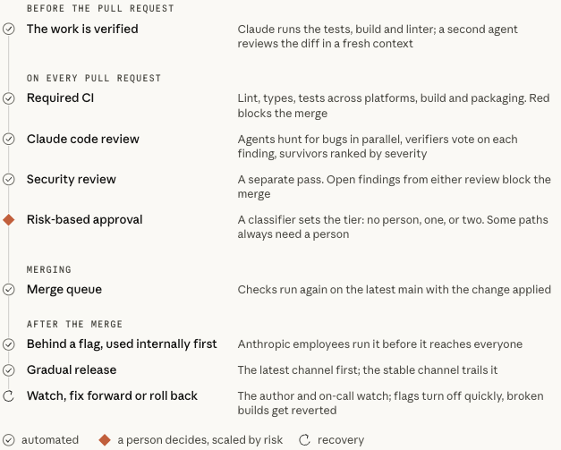
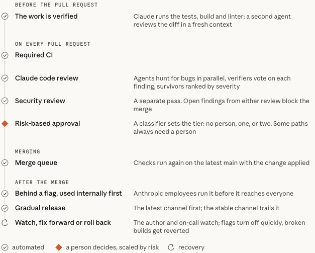
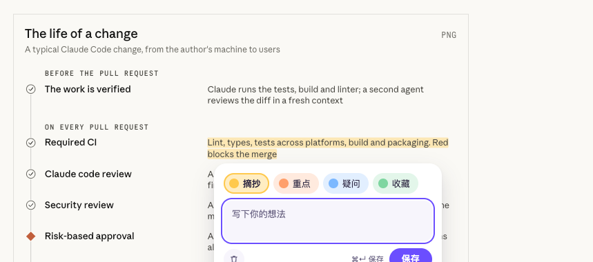
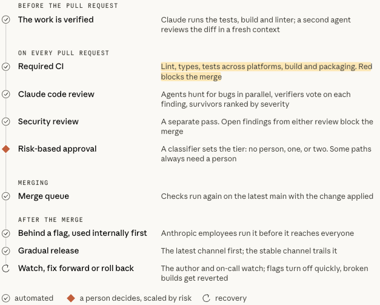
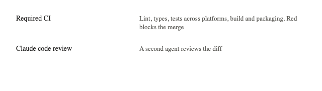
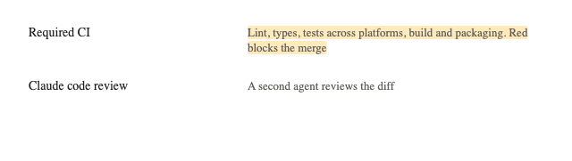
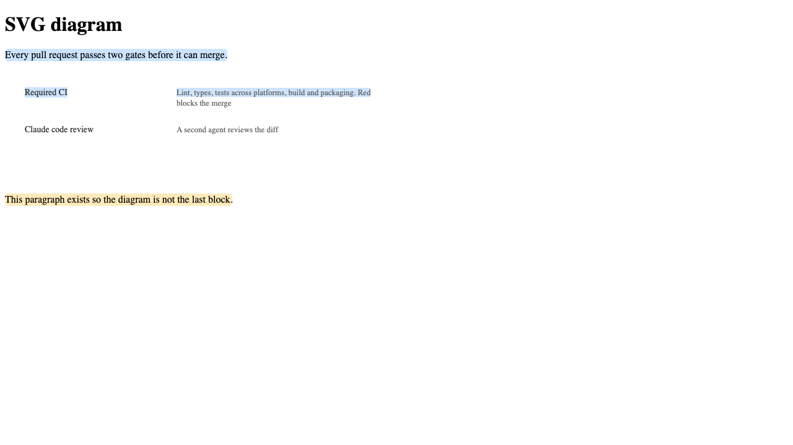

# 测试报告：高亮 SVG 文字后文字消失

## 结论

已修复，并在真实页面上验证通过。修复前，高亮 SVG 图里的文字后，文字会消失。修复后，文字保持原样，背后显示黄色高亮底色；点击能打开高亮弹层，刷新后高亮能恢复。全量回归（单元测试、浏览器测试、typecheck、lint、e2e）全部通过。

## 问题与修复

- 页面：https://claude.dev/blog/solving-code-review-at-anthropic/
- 选中文字：「Lint, types, tests across platforms, build and packaging. Red / blocks the merge」
- 原因：这段文字在内联 SVG 的 `<text>` 元素里。MarkRenderer 用 mark.js 把选中的文字包进 HTML 的 `<mark>`，但 SVG 不渲染 HTML 元素，被包住的文字就画不出来了。
- 修复（`noteit-extension/src/features/highlight/render/mark-renderer.ts`）：
  - `MARK_EXCLUDE` 加入 `svg`，mark.js 不再处理 SVG 里的文字。
  - SVG 里被选中的文字节点，各自在对应 `<text>` 前面插入一个半透明 `<rect class="noteit-svg-highlight">`，作为高亮底色。坐标按父元素的用户坐标系计算，所以 transform 和 viewBox 缩放都能跟上。
  - 换颜色、深色背景适配、闪烁、删除、`clear`、`hitTest`、`boundingRect`、`scrollIntoView` 都支持这些 rect。rect 设了 `pointer-events: none`，点击由 `hitTest` 按 rect 的包围盒判断。
  - TextIndex 和锚点逻辑没改，已保存的高亮不受影响。
- 已知限制：带评论的气泡标记是挂在 HTML `<mark>` 上的 `::after`，SVG 里的 rect 不会显示这个标记。旋转过的 SVG 文字，高亮底色取的是包围矩形。`foreignObject` 里的 HTML 文字暂时不会被绘制。

## 测试环境

- macOS，Playwright Chromium（headless），Node 24.16.0
- 本地 Supabase（docker），测试账号 user A
- 两份构建：修复前（`git stash` 掉修复后构建）和修复后

## 1. 真实页面验证

脚本加载扩展、登录、在 claude.dev 启用站点，用鼠标拖选上面两行 SVG 文字并点黄色。

| 检查项 | 修复前 | 修复后 |
|---|---|---|
| 两行 `<text>` 的宽度（高亮前 → 高亮后） | 363.1 / 104.7 → **0 / 0** | 363.1 / 104.7 → 363.1 / 104.7 |
| SVG 里插入的 `<mark>` 数 | 3 | 0 |
| 高亮底色 rect | 无 | 2 个，填充 `rgba(255, 201, 77, 0.38)`，分别 349×15 和 101×15 |
| 截图里的黄色像素数 | 0 | 4545 |
| 点击高亮文字能否打开弹层 | — | 能 |
| 刷新后高亮能否恢复 | — | 能（2 个 rect，4517 个黄色像素） |
| 记录是否保存 | 是 | 是 |

修复前，高亮前：

修复前，高亮后（"Required CI" 右侧两行消失）：

修复后，高亮后（文字可见，背后有黄色底色）：

修复后，点击高亮文字打开的弹层：

修复后，刷新后恢复：

## 2. 新增回归用例

### 浏览器单测 `mark-renderer.browser.test.ts`

用例「paints SVG text with a visible rect behind it and never wraps it in an HTML mark」：

- 纯 SVG 选区：SVG 里没有 `<mark>`；每个被选中的文字节点对应一个 rect，rect 插在对应 `<text>` 前面，宽度与文字一致，填充色为高亮色；`isPainted`、`boundingRect`、`hitTest` 正常
- 正文跨入 SVG 的选区：正文部分照常绘制成 `<mark>`，SVG 部分绘制成 rect
- 删除后 rect 全部移除，文字宽度不变

### e2e `tests/e2e/svg-text.e2e.ts`

测试页 `tests/e2e/pages/svg-diagram.html` 按博客的结构复刻。

| 用例 | 修复前 | 修复后 |
|---|---|---|
| 高亮 SVG 文字后文字可见并画出 2 个 rect；点击打开弹层；刷新恢复后仍可见 | 失败（SVG 里有 3 个 mark） | 通过 |
| 同页 HTML 段落正常绘制；从正文跨入 SVG 的选区两部分都绘制 | 失败（SVG 里有 4 个 mark） | 通过 |

测试页截图（修复后）：

| 高亮前 | 高亮后 | 刷新后 |
|---|---|---|
|  |  |  |

跨区选区（段落和 SVG 都有高亮底色）：

## 3. 全量回归

| 套件 | 结果 |
|---|---|
| 单元测试 `test:unit` | 57 个文件，573 通过，2 跳过 |
| 浏览器测试 `test:browser` | 11 个文件，49 通过 |
| typecheck | 通过 |
| lint | 通过（1 条警告是已有基线，与本次改动无关） |
| e2e `--project=e2e` | 92 通过 |

## 未覆盖

- 没有在你本机已安装的扩展上手动操作，验证都是 Playwright 驱动的 Chromium 跑的。
- 没有跑 corpus、perf、two-device 套件。
- 没有验证 `VITE_RENDERER=highlight-api` 渲染器下的 SVG 表现（默认构建用的是 mark 渲染器）。
