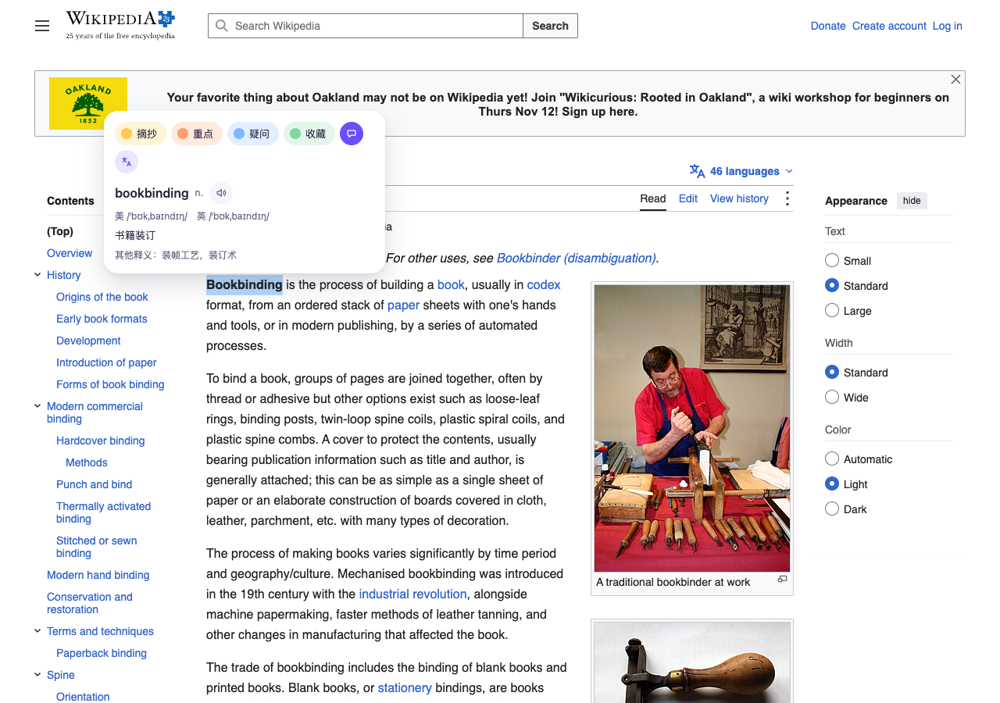
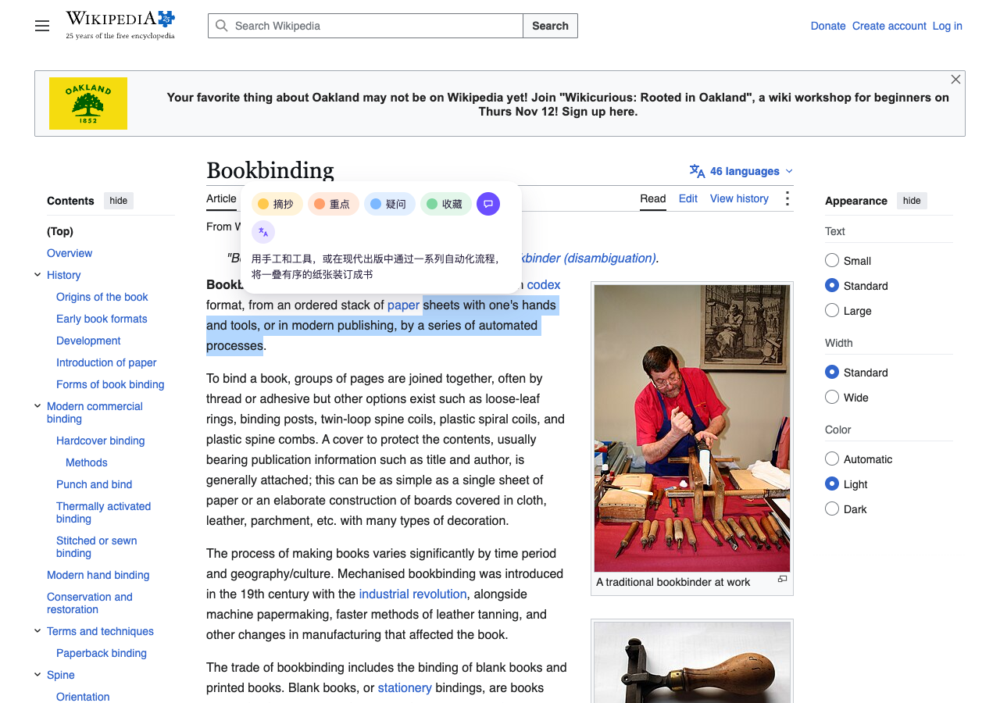

# 测试报告：翻译结果在浮窗内展开

## 结论

改动有效。在真实页面（英文维基百科 Bookbinding）上，用当前构建选中文字后点翻译，结果直接显示在同一个浮窗里，颜色和评论按钮都还在；评论框可以插入译文并随高亮一起保存；页面滚动时浮窗跟着选区移动、不会关闭。这次补上了真实 DeepSeek 接口的冒烟：单词和句子都返回 200，结果正确显示，耗时约 1 秒。对照组（4aaa31f）上新增的 8 个 e2e 用例全部失败，当前构建全部通过。全量回归结果见第 4 节。

## 改动

- 背景：原来点翻译会关掉浮窗、在选区下方另开一张卡片，视线要跳一次，卡片里只能标黄色，也写不了评论。
- 改动（提交 7ee71b1）：
  - `src/features/translate/inpage/TranslatePanel.tsx`：浮窗里的翻译区块，自己发起查询，收起或关闭时取消请求。
  - `src/features/highlight/inpage/FloatingMenu.tsx`：翻译按钮改成开关；展开时只在第一次决定往上还是往下长，加载完成不会翻面。
  - `src/features/highlight/inpage/floating-menu-controller.ts`：新增 `repositionFloatingMenu`，滚动时重新定位，状态保留。
  - `src/ui/inpage/primitives/CommentEditor.tsx`：可选的“插入译文”按钮。
  - `src/content/SelectionManager.ts`：注入翻译区块；滚动和窗口缩放时浮窗跟随选区。
- 已知限制：右键菜单入口仍使用独立卡片；未登录时浮窗不出现，只能走右键菜单。

## 验收标准

| 标准 | 指标 | 结果 |
|---|---|---|
| 翻译结果在同一浮窗内 | 点翻译后浮窗数量、独立卡片数量 | 通过：浮窗 1 个，卡片 0 个 |
| 颜色和评论按钮仍可用 | 展开后浮窗内颜色按钮数量 | 通过：4 个 |
| 翻译按钮可开可关 | `aria-pressed` 状态、收起后翻译区块数量 | 通过：e2e 断言 true → false，区块 0 个 |
| 不遮挡选区 | 浮窗与选区矩形是否相交 | 通过：单词、句子均不相交 |
| 评论可插入译文并保存 | 编辑框内容、`liveRecords` 中的 comment | 通过：与真实译文一致 |
| 滚动不关闭、跟随选区 | 滚动 60px 后浮窗 y 坐标、浮窗是否存在 | 通过：110 → 50，仍存在 |
| 点翻译前不外发请求 | 点击前对接口的请求数 | 通过：0 |

## 测试环境

- macOS，Playwright Chromium（headless），Node 24.16
- 本地 Supabase（docker），测试账号 user A
- 对照组：4aaa31f（改动前）构建 vs 7ee71b1 构建
- DeepSeek：真实接口，模型 `deepseek-flash`，Key 从本地文件读取，未写入报告或日志

## 1. 真实页面验证（en.wikipedia.org/wiki/Bookbinding）

脚本取正文第一段中最长的单词（Bookbinding），以及同一段里最长的一段连续短语（“sheets with one's hands and tools, or in modern publishing, by a series of automated processes”）。

| 检查项 | 改动前（4aaa31f，模拟接口） | 改动后（7ee71b1，真实 DeepSeek） |
|---|---|---|
| 点翻译后浮窗内出现翻译区块 | 否：20 秒内未出现（旧版改为另开卡片） | 是 |
| 单词结果 | — | bookbinding，美/英 /ˈbʊkˌbaɪndɪŋ/，“书籍装订” |
| 短语结果 | — | “用手工和工具，或在现代出版中通过一系列自动化流程，将一叠有序的纸张装订成书” |
| 结果出现耗时 | — | 单词 1113 ms，短语 898 ms |
| 接口状态 / 耗时 | — | 200 / 1020 ms，200 / 870 ms |
| token（输入 / 输出） | — | 单词 289 / 70，短语 138 / 30 |
| 插入译文后保存 | — | 1 条记录，comment 为上面的译文，页面 1 处高亮 |
| 滚动 60px | — | 浮窗 y 从 110 到 50，仍打开 |

单词：

短语：

翻译与评论同时展开，已插入译文：

## 2. DeepSeek 质量抽样（`.scratch/translate/spike.mjs`，20 条）

| 指标 | 结果 |
|---|---|
| JSON 格式正确 | 20 / 20 |
| 义项关键词命中 | 16 / 20 |
| 延迟 p50 / p90 / max | 125 / 292 / 365 ms（脚本直连，不含扩展内的处理） |

4 条未命中的情况：“well-known”给出“众所周知的”，“kick the bucket”给出“翘辫子”，长句保留了英文“Service Worker”，这三条意思都对，只是没用预设关键词；“it”在 “The trophy did not fit in the suitcase because it was too big” 中被译成“它”，没有指代到“奖杯”，属于真实的指代消解失败。几组同形异义词（bank、running、fine、lead）都按上下文给出了不同释义。

## 3. 新增回归用例

`tests/e2e/translate-in-menu.e2e.ts`（替换原来的 `translate-card.e2e.ts`）：

| 用例 | 改动前 | 改动后 |
|---|---|---|
| 单词在浮窗内显示，开关收起，缓存命中，Esc 关闭，axe 检查 | 失败 | 通过 |
| 翻译展开时点颜色按钮完成高亮 | 失败 | 通过 |
| 评论框插入译文并保存 | 失败 | 通过 |
| 未展开翻译时没有插入按钮，编辑时翻译按钮仍在 | 失败 | 通过 |
| 未配置时提示并提供设置入口 | 失败 | 通过 |
| 接口报错后重试 | 失败 | 通过 |
| 点外部关闭浮窗 | 失败 | 通过 |
| 滚动后浮窗不关闭并跟随选区 | 失败 | 通过 |

`src/features/translate/inpage/insertable.test.ts`：插入文本的拼接规则（2 个单测）。

改动前的 8 个用例全部失败，说明这些检查确实能发现问题；`translate-menu.e2e.ts` 和 `floating-menu.e2e.ts` 在当前构建上同样通过（22 个用例一起跑）。

## 4. 全量回归

| 套件 | 结果 |
|---|---|
| lint | 通过（1 个 warning，等于基线） |
| typecheck | 通过 |
| 单元测试 `test:unit` | 通过：616 个，跳过 2 个 |
| 浏览器测试 `test:browser` | 通过：49 个 |
| 模块边界 `test:module-boundary` | 通过：highlight 模块不依赖 translate |
| 集成测试 `test:integration` | 通过：54 个 |
| build + `scan:dist` | 通过：content script gzip 35.1KB，上限 37.9KB |
| e2e `--project=e2e` | 通过：106 个，耗时 6.9 分钟 |

corpus、perf 套件本次没有跑。

## 未覆盖

- `speechSynthesis` 的实际发音：headless 环境听不到。
- 只在 Chromium 上测过，只验证了默认的 mark 渲染器。
- 真实接口只抽样了 20 条加页面上 2 次请求，没有测高并发、限流（429）和超时的真实表现，这几种情况只在模拟接口下测过。
- 浮窗靠近视口顶部、需要向下展开的情况没有专门的用例，也没有在真实页面上验证。
